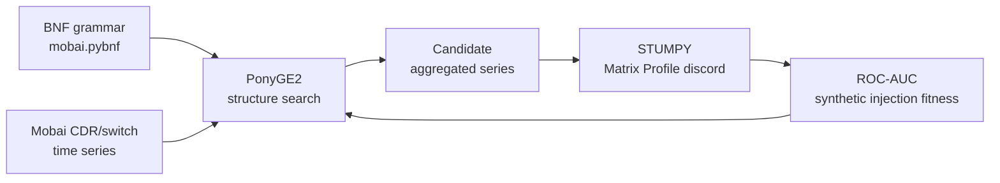

---

## tags: [meta, thesis]

last_updated: 2026-06-26

# Thesis Research Overview

## Topic

This dissertation searches **which hierarchical aggregation of telecom switch/CDR time series** best exposes anomalies for detection. The pipeline combines:

1. **Grammatical Evolution (PonyGE2)** — evolves valid aggregation structures via a BNF grammar (`mobai.pybnf` / `mobai_nop.pybnf`)
2. **Matrix Profile (STUMPY)** — label-free discord scorer applied to each candidate aggregated series
3. **ROC-AUC fitness** — evaluated on synthetically injected anomalies (μ±3σ, 168-hour windows)
4. **Vodafone-style operational data** — Mobai switch/CDR records (see `datasets/Mobai/`)

## Research gap

After reviewing 28 core papers plus Van Onsem et al. (2023), **no reviewed work integrates all four components**:

| Component                                                | Present in literature?                                                      |
| -------------------------------------------------------- | --------------------------------------------------------------------------- |
| Structure / hierarchy **search** (not fixed views)       | Partially — Wolff et al. (hierarchical search), He et al. (subspace search) |
| Matrix Profile as **candidate scorer**                   | Yes — Yeh, Zhu, Keogh, Law; Van Onsem applies MP to telecom KPIs for **motifs**, not discords + search |
| **Telecom operational** data (CDR, KPIs, switch records) | Yes — González, Burgueño, Mefleh, etc. — but fixed aggregations             |
| **AUC-based** evaluation on injected anomalies           | Partially — Contreras (GA+AUROC); not in telecom hierarchy context          |

The thesis fills this gap by using GE to search aggregation structures, MP to score each candidate without labels, and AUC to rank structures on synthetically injected anomalies in real telecom data.

## Literature sections (Chapter 3)

Each section closes with a gap sentence pointing to the next or to the integrated framework.

| #   | Section                                              | Articles | Section argument                                                      |
| --- | ---------------------------------------------------- | -------- | --------------------------------------------------------------------- |
| 1   | Anomaly Detection in Telecommunications Networks     | 1–4      | Labels are scarce; fixed views underperform; aggregation matters      |
| 2   | Anomaly Detection in Grouped Time Series             | 5–8      | Representation/grouping dominates detector choice                     |
| 3   | Anomaly Detection in Hierarchical Time Series        | 9–12     | Hierarchy enables localisation and search; forecasting ≠ detection    |
| 4   | Matrix Profile and Discord Detection                 | 13–16, 29 | Label-free scorer; Van Onsem: MP motifs on telecom KPIs, not discords |
| 5   | Combinatorial Optimisation for Selecting Time Series | 17–20    | Selection is combinatorial; EC + fast scorer + AUC fitness            |
| 6   | Combinatorial Optimisation in Anomaly Detection      | 21–24    | Anomalies live in selected subspaces; scorer + search combined        |
| 7   | Genetic Programming and Grammatical Evolution        | 25–28    | Grammar generates valid interpretable hierarchies; PonyGE2 implements |
| —   | Research Gap                                         | —        | No work integrates structure search + MP + telecom + AUC              |

**Article counts:** Core 12 · Supporting 13 · Optional 3 · Ch. 2 mainly 1 · Extra (telecom MP) 1 · **Total 29**

**Merge when writing:** González et al. (2024) + García González et al. (2022); Yeh et al. (2017) + Yeh et al. (2016).

## Writing rules

1. Prioritise **application and reported results** over method theory.
2. If no accessible numeric result exists, **state so explicitly**.
3. **Do not compare** synthetic-injection AUC directly to expert-label or range-F1 papers without qualification.
4. Port prose from `Literature Review - Dellmified Draft.md` → `Latex Document/3-literature-review.tex`.
5. Close each section with a **gap sentence**.

## Current thesis status

Last audited: 2026-06-15 · Overall ~33% complete (17/52 checklist items).

| Chapter                 | Status                   | Notes                                                        |
| ----------------------- | ------------------------ | ------------------------------------------------------------ |
| Ch. 1 Introduction      | partial                  | Motivation and objectives need polish                        |
| Ch. 2 Theory            | partial                  | Anomaly detection / Matrix Profile stubs incomplete          |
| Ch. 3 Literature Review | **not started in LaTeX** | MD draft exists; 28 article notes ready; wiki ingest pending |
| Ch. 4 Methodology       | partial                  | Grammar and injection described; fitness details incomplete  |
| Ch. 5 Results           | outline                  | Blocked on experiment outputs                                |
| Ch. 6 Conclusions       | outline                  | Blocked on Ch. 5                                             |

**Blocking dependencies:**

- Ch. 3 rewrite ← port MD draft + ~25 bibliography entries
- Ch. 5 ← `src/mobai.txt`, `results_*.csv`, `check_results.ipynb`
- Ch. 6 ← Ch. 5 numeric results

## Wiki status

- **Schema:** `[CLAUDE.md](../CLAUDE.md)` at repo root
- **Raw sources:** 29 article notes in `[Literature Review Articles/](../Literature%20Review%20Articles/)`; 26 PDFs on disk in `[Literature Review PDFs/](../Literature%20Review%20PDFs/)` (3 missing: articles 22, 25, 27)
- **Ingested sources:** 29 / 29 — all article notes in `wiki essay/sources/`
- **Concept pages:** 11 · **Entity pages:** 5 · **Synthesis:** [[research-gap]]
- **Next step:** Query wiki to draft Ch. 3 prose, or lint for cross-reference health

## Key cross-references

- Article notes: [Literature Review Articles/](Literature%20Review%20Articles/)
- Wiki sources: [wiki essay/sources/](sources/)
- Progress: [Thesis Status Checklist.md](../Thesis%20Status%20Checklist.md)
- Draft prose: [Literature Review - Dellmified Draft.md](../Literature%20Review%20-%20Dellmified%20Draft.md)

